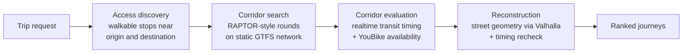

# Via

[](https://github.com/chengpong1127/Via/actions/workflows/server.yml)

**Door-to-door journey planning across Taiwan that combines public transit, YouBike, and walking.**

Most trip planners treat bike-share as an afterthought. Via plans multimodal journeys end to end. It can tell you to ride a YouBike to the MRT, take the metro, then walk the last block, using realtime transit timing and live bike availability.

Via has two parts: a **Rust journey-planning server** and a **native SwiftUI iOS app** modeled on the Apple Maps experience.

## Features

- **Multimodal routing:** combines bus, metro, TRA, THSR, YouBike, and walking in a single journey
- **Realtime aware:** uses live transit timing and YouBike availability from Taiwan's TDX platform
- **Two-phase planner:** a fast static transit search finds candidate routes, then a realtime pass checks which ones actually work right now
- **Nearby stops:** lists transit stops and YouBike stations near you, with live bike availability
- **Native iOS app:** full-screen map, bottom-sheet search, place cards, and transit directions in SwiftUI and MapKit
- **Production-minded server:** request deadlines, concurrency limits, Prometheus metrics, an OpenAPI schema, and Docker Compose for local development

## How it works



1. **Access discovery** finds walkable boarding points near the origin and destination.
2. **Corridor search (phase 1)** runs a round-based, RAPTOR-style search over a static transit network built from GTFS. Each round adds one ride. Via keeps the best corridor for each ride count, plus near-best alternatives.
3. **Corridor evaluation (phase 2)** checks each candidate corridor against realtime TDX transit timing and live YouBike availability, expanding transit, walking, and bike-share legs and pruning infeasible options. Direct walking is always evaluated too.
4. **Reconstruction** fills in street-level geometry with [Valhalla](https://github.com/valhalla/valhalla), rechecks timing, and ranks the usable journeys.

Static data is preprocessed offline into one validated artifact, so request-time work stays focused on realtime evaluation. For more detail, see [CONTEXT.md](CONTEXT.md).

## Tech stack

| Area | Technologies |
| --- | --- |
| Server | Rust, Axum, Tokio, OpenAPI, Prometheus |
| Routing data | GTFS, TDX (realtime transit + YouBike), Valhalla, OpenStreetMap |
| iOS | Swift, SwiftUI, MapKit, Core Location |
| Infrastructure | Docker, Docker Compose, GitHub Actions |

## Quick start

### Server

```sh
# 1. Add TDX credentials
cp server/.env.example server/.env

# 2. Fetch source data and build the static artifact (requires Valhalla running)
cargo run --manifest-path server/Cargo.toml --bin via-data -- fetch
cargo run --manifest-path server/Cargo.toml --bin via-data -- build
cargo run --manifest-path server/Cargo.toml --bin via-data -- validate

# 3. Start the server and Valhalla
VIA_STATIC=/app/server/data/build/<timestamp>/.via-static.json \
  docker compose -f server/docker-compose.yml up --build
```

The API runs at `http://127.0.0.1:3000`. Main endpoints:

| Endpoint | Purpose |
| --- | --- |
| `POST /v1/journey-plans` | Plan multimodal journeys |
| `GET /v1/nearby-stops` | Nearby transit stops and YouBike stations |
| `GET /openapi.json` | API schema |
| `GET /metrics` | Prometheus metrics |

For configuration and verification commands, see [server/README.md](server/README.md).

### iOS app

Open `ios/Via.xcodeproj` in Xcode 27+, choose the `Via` scheme, and run it on an iPhone simulator (iOS 26+). Debug builds talk to the local server at `http://127.0.0.1:3000`. For details, see [ios/README.md](ios/README.md).

## Project structure

```
server/   Rust journey-planning server, data pipeline (via-data), and tests
ios/      SwiftUI + MapKit iOS client
```

## Status

Via is under active development. Journey planning and nearby stops work end to end. Turn-by-turn navigation is not implemented yet.
