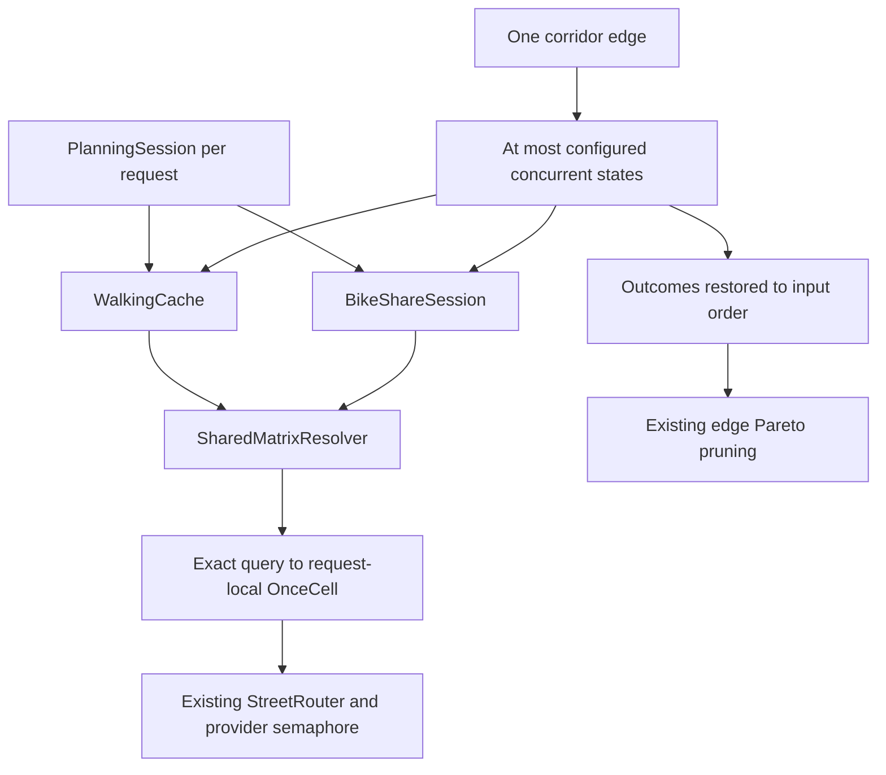

# Phase B: shared Matrix resolution and parallel state expansion

Phase B keeps corridor and edge traversal sequential and expands the retained
states of each edge concurrently. `ExpansionResolver::expand_state(&self)` keeps
Transit → Walking → BikeShare ordering within a state. Its transition helpers
remain deterministic. `expand_edge` observes completions promptly, restores input
order, and returns one aggregated `ExpansionOutcome` before the existing pruning
pass. P1, reconstruction, ranking, frontier limits and provider safeguards are
unchanged. No work budget or corridor cap is added.

## Ownership and keys

`MultimodalPlanner::prepare` creates one `Arc<SharedMatrixResolver>` after loading
request snapshots. Walking owns a clone and the request-local BikeShare planner
receives another clone as its `StreetRouter`. The long-lived planner/provider is
never modified. The resolver delegates `matrix_limits` and `route` unchanged.
There is no global cache, eviction timer, task spawn, or background worker. All
entries and completed results disappear with the planning session.

The Matrix key includes orientation, travel mode, ordered source and target
coordinate vectors, and the complete typed `RoutingConstraints` (time kind,
full `PrimitiveDateTime`, and optional maximum distance). Coordinates are checked
for finite values and valid ranges, then represented by their exact IEEE bits.
Positive and negative zero remain conservatively distinct. No time bucketing,
geographic rounding, serialization hash, or hash-only identity is used. Hash-map
collisions still compare complete keys. Destructuring `MatrixQuery` without a
wildcard makes new query fields require an explicit key decision.

Walking uses a `(from anchor key, to anchor key)` movement cache, preserving
direction, coordinates, boarding identity and errors. Phase B.1 intentionally
treats pedestrian and bicycle Matrix durations and distances as time-independent.
States with different departure times can share a movement result, while each
transition applies its duration to the state’s own `ready_at`. BikeShare endpoint
walking and bicycle matrices also use default, time-free constraints. The general
Matrix key still includes all constraints for other callers. Omitting Valhalla’s
`date_time` can change reachability, duration, distance or route choice on
time-restricted infrastructure; this model is not a claim that such routes are
always time-independent. BikeShare retains its directional anchor-pair candidate cache (including
`None`) and realization cache (including errors). Candidate discovery holds a
short synchronous lock; async realization holds no session-wide lock. Realized
BikeShare movements are still remapped to the requesting indices. Availability,
pickup walking → pickup filtering → dropoff walking → dropoff filtering → bicycle
Matrix dependencies, station ordering, endpoint restrictions and rental
continuation remain unchanged.

## Single-flight and cancellation

The focused `RequestCache<K, V>` stores an `Arc<tokio::sync::OnceCell<V>>` per key.
The map mutex covers only lookup/registration. A cell serializes initialization
for its own key while distinct keys proceed independently.

| State at lookup | Action |
| --- | --- |
| Missing | Register a cell and initialize it through provider I/O. |
| In flight | Await that cell; do not start another provider operation. |
| Ready | Clone the stored success or error. |
| Initializer canceled | Tokio releases initialization; a remaining or later waiter can initialize the empty cell. |

Canceling an ordinary waiter leaves the initializer running. Canceling the
initializer drops its provider future, releases its provider permit, and allows
another waiter to take over. That takeover can issue a replacement physical
operation; this exception is measured and tested rather than claimed to be one
operation across cancellation. There is no detached task and no lost-wakeup
`Notify` protocol. If every waiter is dropped, no provider future survives. An
empty cell can remain until session drop but is immediately retryable.

The edge collector applies the absolute request deadline to each wait for a
completion. It drops remaining futures immediately on timeout or the first
observed fatal outcome. Fully successful outcomes merge in state input order.
Fatal runs preserve all completed outcomes already observed, aggregated in input
order, including higher-index completions. Unfinished states can have speculative
I/O and partial local operation counts that never become completed outcomes.
Provider/cache counters still record attempted or canceled operations. The
first observed fatal error can differ from the first input-index error. No
partial edge frontier is pruned or returned as a successful result.

`PlanningSession::evaluate` now copies partial evaluator statistics and failures
before propagating an error. The evaluator's deadline handling replaces the
former outer session timeout, allowing completed outcomes to be retained. An
external cancellation still drops the entire borrowed evaluation immediately.

## Error policy

Completed Matrix successes, unreachable cells, `Unreachable`, transient errors
(`Timeout`, rate limits, temporary unavailability), and internal errors are all
cached for the request. Invalid local query keys are rejected before provider
I/O. No error is converted into a success or assigned a new failure class.
Existing Walking/BikeShare classification and fallback logic consumes the same
error value.

There is one deliberate retry-policy difference: different movement keys that
produce exactly the same Matrix query now share its failure. Previously, the
second movement key could retry that query and recover if the provider recovered
mid-request. A fail-once regression test demonstrates both behaviors: two raw
BikeShare anchor pairs make two calls and the second succeeds; the shared request
makes one call and both receive the timeout, retaining their existing fallbacks.
A fresh request succeeds. Completed errors are retained consistently with the
existing movement-cache policy; cancellation is never stored as a provider error.

## Limits and statistics

`[routing].max_concurrent_phase2_states` defaults to 4. TOML validation accepts
1–32; direct query limits are clamped to this same range at execution. Values
1, 2, 4 and 8 are exercised. Concurrency 1 uses the same cache and collector and
is a sequential reference. Valhalla's existing semaphore limit stays at 8 and
its timeout continues to cover semaphore waiting. No provider setting changes.

`Phase2EvaluationStats.matrix` separates logical resolver calls, completed hits,
in-flight hits, unique misses, delegated provider attempts, provider failures,
provider timeouts, canceled attempts and maximum delegated overlap. At quiescence
for valid queries, logical = misses + completed hits + in-flight hits. Without
cancellation, attempts = misses. With canceled initialization, attempts can be
larger because takeover retries the empty cell.

Delegated attempts and overlap include time spent inside the provider waiting
for its semaphore; they are **not an HTTP concurrency measurement**. Benchmark
mocks independently record actual active operations after their semaphore,
physical calls, bicycle calls and accumulated semaphore waiting. No claim about
live HTTP call counts is made from these deterministic mocks.

Walking requests retain the meaning of attempted movement-cache initialization;
walking hits now include both completed and overlapping movement reuse. BikeShare
exact requests remain completed unique realization-cache entries; exact hits
include completed and overlapping reuse. BikeShare Matrix requests count logical
calls made by its realization algorithm, even if the lower resolver reuses them.
A drop guard preserves attempted BikeShare Matrix counts on cancellation.
Per-state operations/successors remain outcome-based, with no atomic statistics
in the transition helpers and no expansion-wide mutex.

## Verification and measurements

See [measurements](measurements.md) for Phase B release results and reproduction commands, and [Phase B.1 measurements](phase-b1.md) for the time-independent comparison.
The controlled tests cover query identity, overlapping misses, cached errors,
request isolation, reverse completion, partial fatal outcomes, cancellation,
BikeShare remapping/rentals/filtering, complete corridor evaluation and ordered
journey equivalence. Integration tests compare reconstructed, ranked Top-3
options at concurrency 1, 2, 4 and 8.

Remaining bounds are sequential corridors/edges, BikeShare's dependent Matrix
chain, distinct Matrix queries that cannot share results, the provider semaphore and
CPU/cache overhead for zero-delay workloads. No cross-state Matrix batching or
cross-request caching is attempted.
