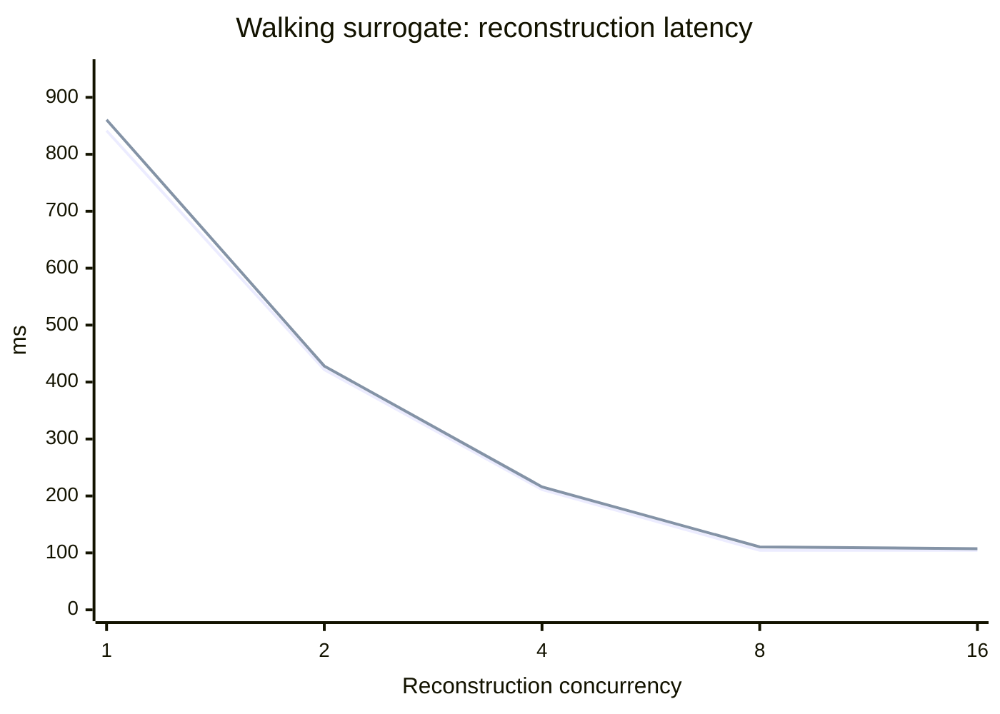
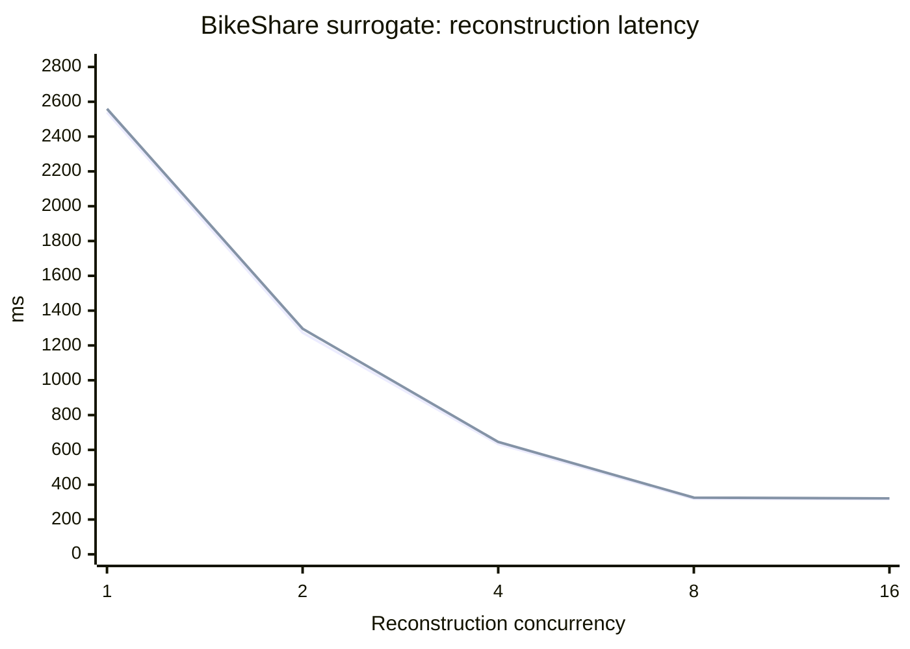
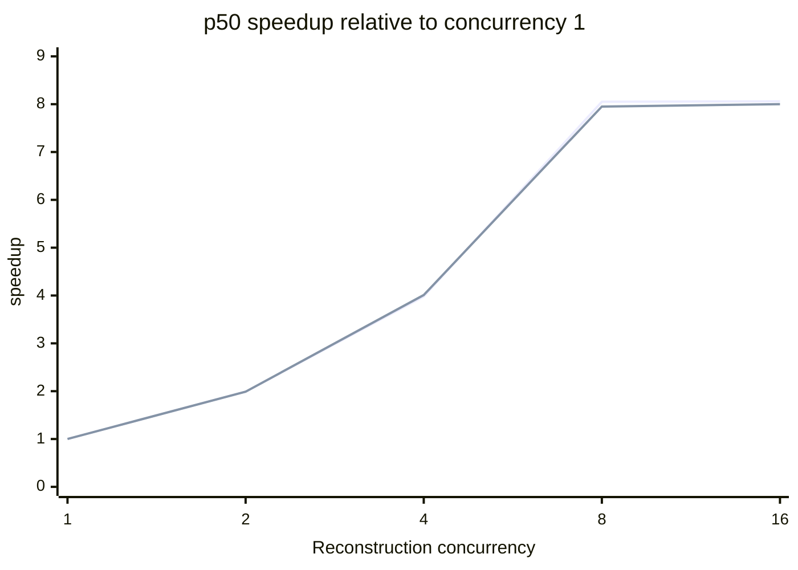
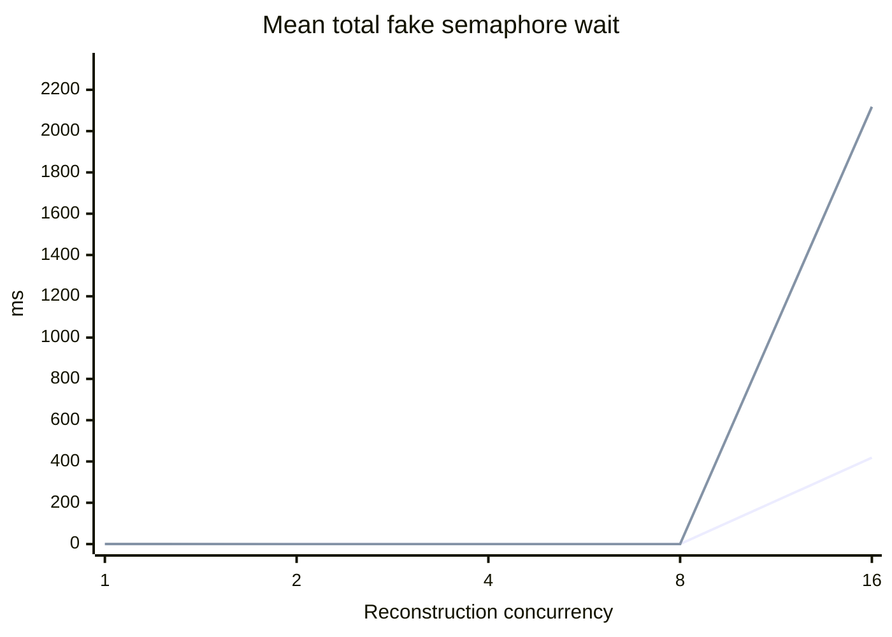

# Reconstruction concurrency benchmark — partial results

This earlier experiment does **not** measure either requested Transit Only or Transit + YouBike workload or end-to-end routing. A later [planner-generated candidate benchmark](reconstruction-representative-benchmark.md) reports representative replay and its remaining limitations. The current default of 4 remains unchanged because these surrogate results do not support a production recommendation.

## Scope and method

Reference commit `ca3b01a0cfcb5c98020c66788adfc33b29af7e1f`, branch `p2-optimization`. `RoutingService` uses `stream::iter(futures).buffered(concurrency)` and consumes results in input order. Phase 2 is independently configured to 4 in the tracked configuration; the benchmark bypasses Phase 2 entirely. Valhalla is configured for 8 concurrent operations and its 1200 ms timeout wraps semaphore acquisition and the request.

The ignored release-mode unit benchmark invokes the actual `JourneyReconstructor` through the same ordered reconstruction helper with 16 identical, fixed synthetic journeys: one direct walking movement, or one BikeShare movement (walking to pickup, cycling, walking from dropoff). These fixtures do not contain transit and are not planner-captured candidates. The fake router returns fixed geometry and 60-second path durations, sleeps for 0, 10, 50, or 100 ms per Route call, and applies an eight-permit semaphore. It has no timeout or real HTTP. Each configuration uses three warmups and 20 measurements; measured wall time starts immediately before creating the buffered stream and ends after collection, excluding fixture setup and output serialization. Wait is the **sum** of fake semaphore acquisition times across calls, not wall time. Tokio sleep scheduling and host load affect observed durations. Measurements used aarch64 Linux, 8 reported CPUs and 7.8 GiB RAM, with substantial swap usage. Only the 16-candidate pool was tested; 64, 256 and approximately 1,000 are unmeasured.

Run `cd server && cargo test --release --lib reconstruction_concurrency_measurement -- --ignored --nocapture`. The rows below show the 50 ms delay; all 0/10/50/100 ms samples and aggregates are in the CSV and JSON. Percentiles use linear interpolation of sorted observations. The p95 is based on 20 samples and is indicative only. Fake wait and fake calls must not be interpreted as Valhalla HTTP measurements. Request-level Phase 2 and Valhalla configuration columns in the CSV are blank because neither runs here.

## Walking-only surrogate, 50 ms per fake Route

| Concurrency | p50 ms | p95 ms | p50 speedup | Fake wait ms (mean) | Max fake active |
|---:|---:|---:|---:|---:|---:|
| 1 | 841.47 | 860.66 | 1.00× | 0.02 | 1 |
| 2 | 421.88 | 428.12 | 1.99× | 0.08 | 2 |
| 4 | 211.34 | 215.99 | 3.98× | 0.00 | 4 |
| 8 | 104.59 | 110.54 | 8.05× | 0.00 | 8 |
| 16 | 104.45 | 107.36 | 8.06× | 418.39 | 8 |

First line is p50; second line is p95.

## BikeShare-only surrogate, 50 ms per fake Route

| Concurrency | p50 ms | p95 ms | p50 speedup | Fake wait ms (mean) | Max fake active |
|---:|---:|---:|---:|---:|---:|
| 1 | 2539.70 | 2559.74 | 1.00× | 0.06 | 1 |
| 2 | 1274.22 | 1296.37 | 1.99× | 0.03 | 2 |
| 4 | 633.50 | 645.47 | 4.01× | 0.02 | 4 |
| 8 | 319.32 | 325.69 | 7.95× | 0.01 | 8 |
| 16 | 317.29 | 321.59 | 8.00× | 2117.96 | 8 |

First line is p50; second line is p95.

## Simulated speedup and contention

First line is walking, second line is BikeShare.

First line is walking, second line is BikeShare. This chart shows aggregate fake semaphore wait; real Route timeout counts are unavailable.

The fake provider limits active operations to eight, so candidate concurrency above eight can accumulate permit wait. This model does not include the real provider's deadline and cannot establish whether timeouts increase. Ordered buffering can stall admission behind a slow earlier candidate even if later futures finish; identical delays and identical candidates do not measure this head-of-line effect.

## Correctness and gaps

The benchmark asserts equality of serialized `JourneyOption` values in order for all repetitions and levels within each delay. This checks fixture geometry and timelines, including bike legs, but does not test diverse identities, final ranking, result-local IDs, unreachable routes, provider errors, deadlines, or actual transit. Existing `bounded_futures_overlap_and_keep_input_order` and `dropping_buffered_work_releases_active_futures_and_permits` test ordering and cancellation of buffered futures, independently of this fixture. No data races are demonstrated by these tests.

A subsequent real-Valhalla surrogate run is described below. In this surrogate run, exact HTTP attempts, semaphore wait, and provider HTTP concurrency were not measured. No end-to-end chart can be drawn without inventing data. End-to-end samples also require a running service and physical TDX attempt accounting including retries; quota was not verified, so no TDX requests were sent. No production p95, optimal concurrency, or unacceptable contention threshold can be inferred.

For the missing experiment, capture representative planner-produced transit and mixed pools, instrument actual HTTP starts/completions and permit waits, and run isolated configurations at 1, 2, 4, 8 and 16 with Phase 2 fixed at 4 and Valhalla fixed at 8. Verify correctness including ranking, IDs, errors and deadlines, then run quota-accounted bounded endpoint samples. Do not use Matrix initialization counts as Route calls.

## Real Valhalla surrogate comparison

On 2026-10-28 around 14:13 Taipei time, the endpoint `http://valhalla:8002/` reported version 3.9.0 and returned routes from the Taiwan tiles. The release test reused the same fixed, repeated walking-only and BikeShare-only pools described above, with a fixed departure of 2026-08-31 10:00 Taipei time and disabled planning deadlines. These are not the requested transit workloads. After a small pilot, seven independent process runs each performed one warmup and three measured repetitions for each setting: 21 measured samples and seven warmups per cell. Each process reused one Valhalla provider across settings, with its configured 8-permit limit and 1,200 ms timeout. No Matrix or TDX requests were made. Results may be affected by host and service load; p95 from 21 samples is indicative only.

The provider observer records a Route *operation* after it finishes. Its duration includes semaphore waiting, transport and parsing, and is rounded down to milliseconds. It does not expose semaphore wait, HTTP attempt counts, or maximum active HTTP requests. All recorded operations returned successfully, and no candidate was rejected or failed. Identical serialized option digests were observed in each fixture across all settings. This does not establish ranking, result-local IDs, or transit correctness.

### Walking-only surrogate

| Concurrency | p50 ms | p95 ms | p50 speedup | Route operation timeouts |
|---:|---:|---:|---:|---:|
| 1 | 88.57 | 104.14 | 1.00× | 0 |
| 2 | 55.05 | 71.94 | 1.61× | 0 |
| 4 | 40.14 | 53.54 | 2.21× | 0 |
| 8 | 30.61 | 40.94 | 2.89× | 0 |
| 16 | 28.66 | 41.94 | 3.09× | 0 |

### BikeShare-only surrogate

| Concurrency | p50 ms | p95 ms | p50 speedup | Route operation timeouts |
|---:|---:|---:|---:|---:|
| 1 | 167.27 | 205.18 | 1.00× | 0 |
| 2 | 114.20 | 165.91 | 1.46× | 0 |
| 4 | 82.90 | 117.12 | 2.02× | 0 |
| 8 | 64.86 | 79.55 | 2.58× | 0 |
| 16 | 69.46 | 116.34 | 2.41× | 0 |

The BikeShare surrogate's p50 improved from 4 to 8 and increased from 8 to 16; its observed p95 also increased at 16. The walking surrogate's p50 changed little from 8 to 16. This is consistent with diminishing returns, but the unavailable semaphore and HTTP-level instrumentation means the cause cannot be attributed to Valhalla saturation. Keep the default at 4 pending representative workloads and end-to-end evidence.

Reproduce with `cd server && cargo test --release --lib reconstruction_valhalla_pilot -- --ignored --nocapture`; the recorded expanded run executed the resulting test binary seven times. The raw CSV distinguishes `valhalla_3.9.0` from `deterministic_fake` and leaves unavailable metrics empty.
