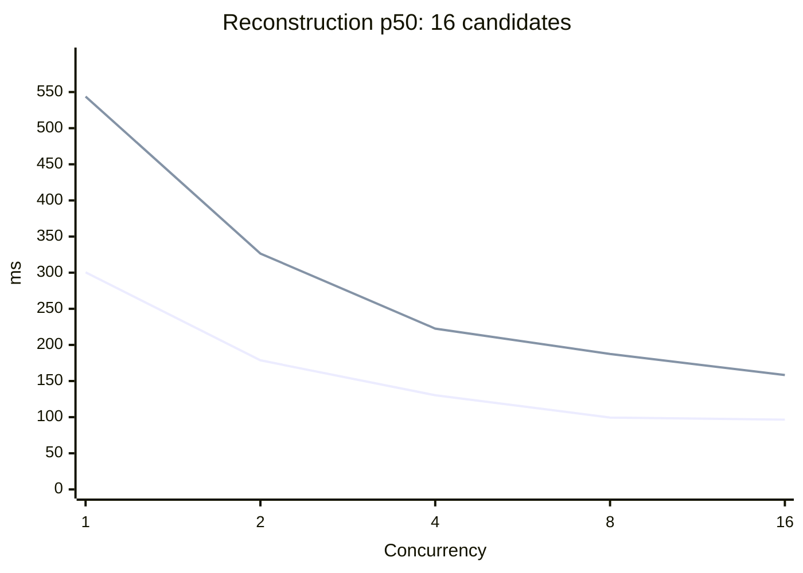
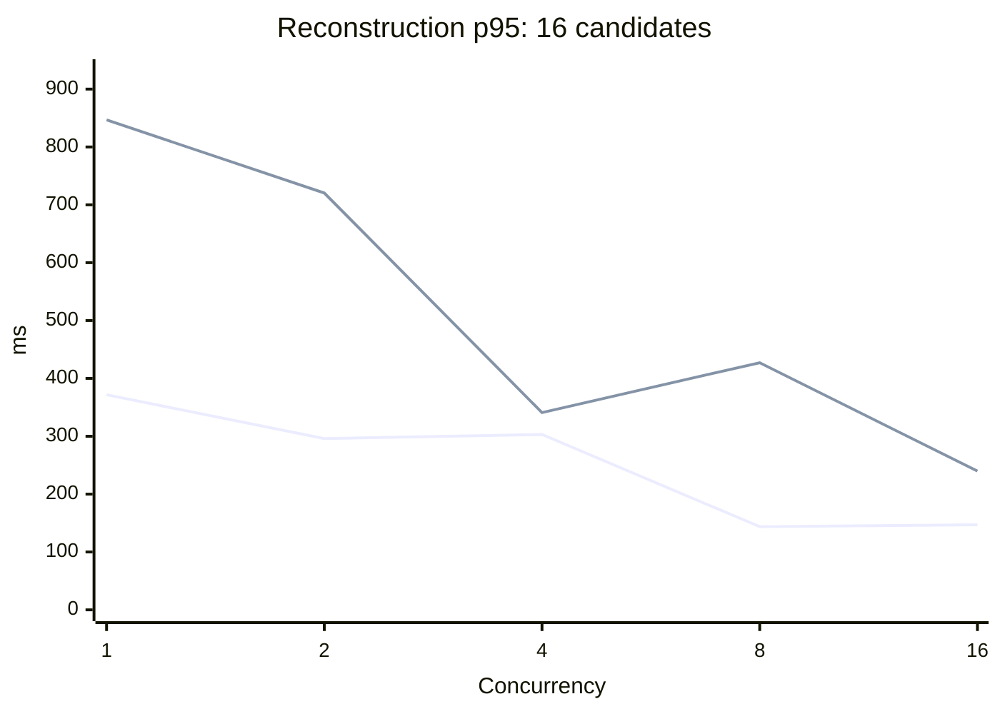
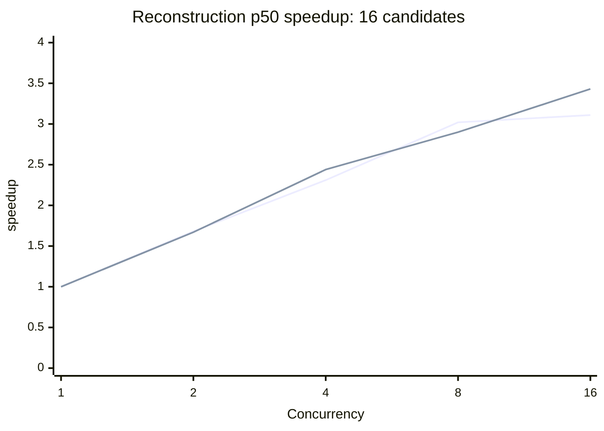
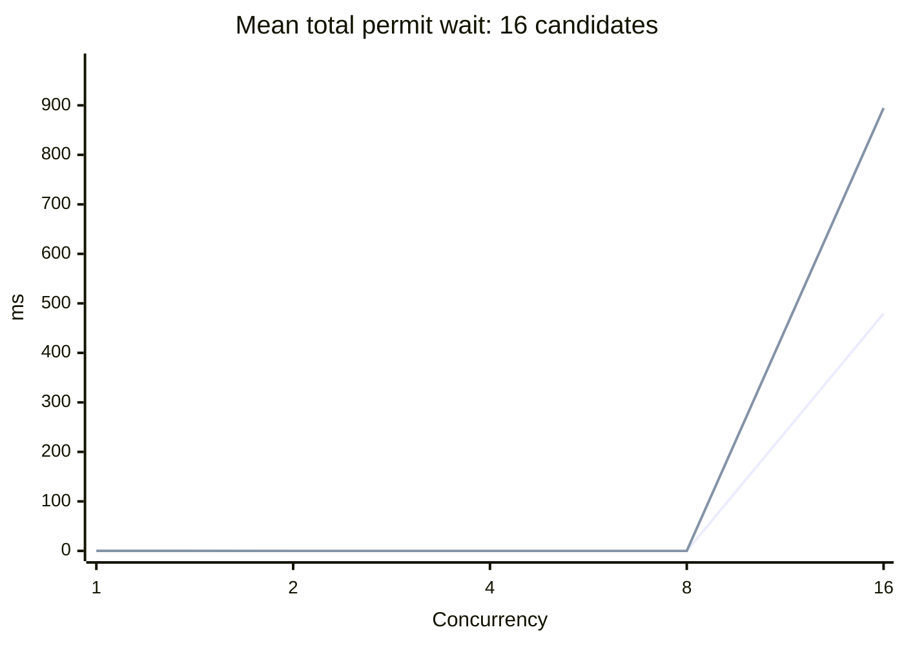
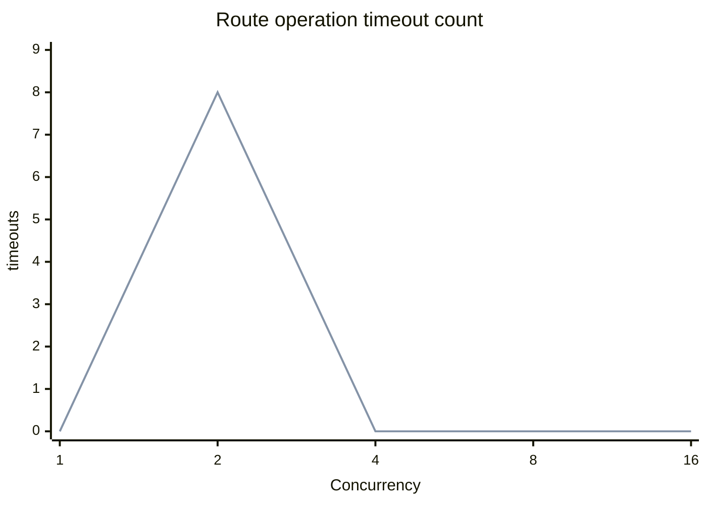
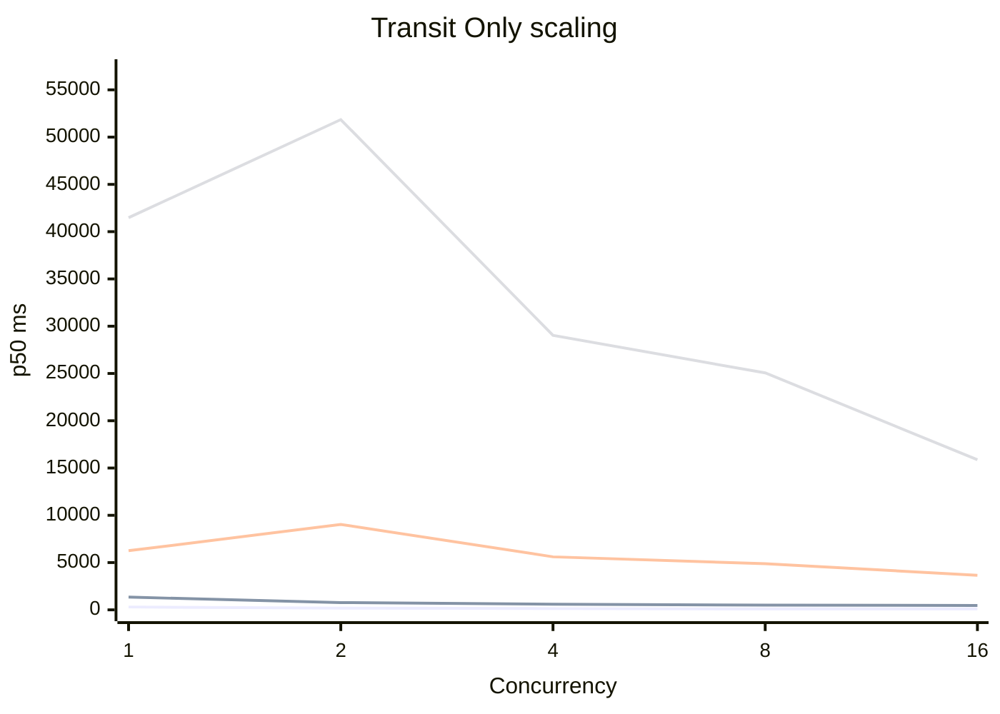
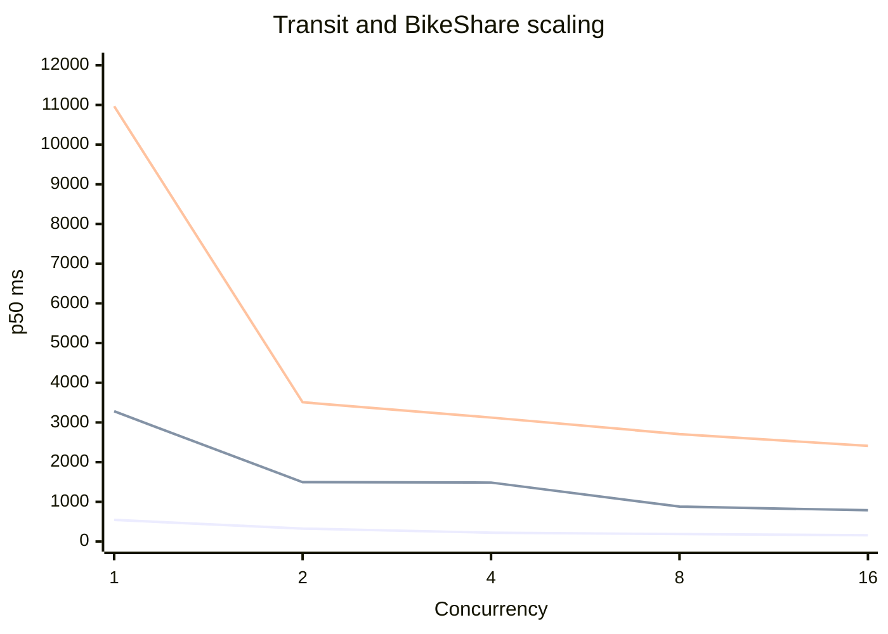

# Representative reconstruction concurrency benchmark

The real planner produced **1,139 Transit Only candidates** and **242 Transit + BikeShare candidates**. Replaying fixed subsets against Valhalla showed lower median reconstruction latency at concurrency 8 than 4 in every measured pool. Concurrency 16 accumulated substantial permit wait. These results are not sufficient to change the default of 4: the full pools have only one sample per setting, larger subsets have only two to five samples, and host load and an eight-timeout episode affected the run.

## Candidate provenance and controls

The ignored test `capture_representative_pools` loads `server/data/build/20261001T173300Z/.via-static.json`, revision `sha256:b15366f9251bbdf9a2a3e8cef10ce3d7ab77ad0d929f683e8e7fab382659fa48`. It uses the same 2026-10-01 10:00 Taipei departure, Taipei Main Station (25.0478, 121.5170) to Xinyi (25.0338, 121.5645), production `via.toml` routing limits, P2 concurrency 4, and Valhalla Matrix routes for each capture. Planning deadlines are disabled. The data is from a historical GTFS snapshot, not a current live timetable.

The actual `MultimodalPlanner.prepare` and `PlanningSession.evaluate` are run once per workload, and the resulting `RealizedJourney` objects are retained in memory for replay. A deterministic `ScheduleTiming`-based snapshot supplies static/frequency timetable fallback; no live timing evidence is supplied, and sparse bus service without scheduled trips is consequently underrepresented. The test supplies a synthetic availability snapshot with 5 bikes and 5 docks at every requested station using the real station catalog; these are not observed availability counts. The snapshot fixture is useful for exercising real movement combinations but does not represent a measured live service state. No TDX calls were made. Timing fixture query errors are currently treated as empty departures, so no claim is made that every possible timetable lookup succeeded.

Transit Only contained 1,095 candidates with transit; mixed contained 196 with transit and 240 with BikeShare. Each 16, 64, and 256 subset selects indices `floor(i * (N - 1) / (size - 1))`, retaining original order without duplication or fabricated journeys. The full pool uses all candidates. The mixed pool is smaller than 256; its full size is 242. The first Transit Only sweep was interrupted before the full pool after timeouts and elevated load; the full pool was recaptured and replayed in a separate run after the environment restarted. Each sample records the fixed pool's canonical-identity digest.

Each process uses a long-lived Valhalla 3.9.0 provider at `http://valhalla:8002/` with concurrency 8 and a 1,200 ms timeout including permit wait. Only reconstruction is timed: start immediately before the production `ordered_reconstruction` stream, stop immediately after collection. Planning, provider construction, final ranking, and report serialization are outside the wall time. The normal production `RankingPolicy` and `rank_candidates` generate the result-local IDs and ranked outputs. Concurrency levels rotate between repetitions. The 16-candidate pools have 3 warmups and 20 samples per cell. Transit Only 64 has 3 warmups and 5 samples; mixed 64 has 3 warmups and 3 samples; Transit Only 256 has 1 warmup and 2 samples; each full pool has 1 warmup and 1 sample. P95 is shown only for 20-sample cells, using linear interpolation; even those tail estimates are indicative rather than production-grade.

These experiments ran 2026-10-28 approximately 15:30–15:41 Taipei time, with the full Transit Only retry around 17:07–17:12 following an environment restart on aarch64 Linux with 8 reported CPUs, 7.8 GiB RAM and 8.8 GiB swap. Swap usage was about 7–8 GiB; load averages climbed above 11 during the Transit Only sweep and were higher during the subsequent rebuild. The comparisons are sensitive to load, cache warmth, and elapsed time between settings. They do not establish live or end-to-end performance.

## Physical instrumentation

Opt-in `cfg(test)` counters surround the provider's actual Route semaphore acquisition and request send; production behavior and provider limits are unchanged. A send attempt is counted immediately before invoking reqwest; completed status, incomplete operations, active sends, and acquisition wait are recorded separately. `http_total_ms` covers sending through response-body parsing and therefore includes JSON decoding, and operation latency additionally includes permit wait; the per-operation observer rounds down to milliseconds. The counters do not see transport-internal retries or packet-level retransmissions, so they count application HTTP sends, not independently traced wire attempts. HTTP error statuses and incomplete sends are separate; an incomplete send may represent transport failure, timeout or cancellation. Logical Route timeouts include waiting for a permit. Wait samples include acquisition attempts canceled by the outer deadline; `max_waiting` counts active acquisition attempts including immediate acquisitions. Maximum permit holders and decoding time separately are unavailable. Summed waits overlap and must not be read as wall-clock latency.

The 260 recorded samples issued 99,602 application HTTP sends: 99,594 successful HTTP responses and eight incomplete sends. Eight Route operations timed out, all in one Transit Only 256-candidate, concurrency-2 sample during high load; permit waits in that sample were below 0.1 ms. No other candidate errors were recorded in measured samples. Warmup traffic is excluded from the raw measured totals. Matrix traffic occurs only during capture, outside replay.

## Transit Only

### 16 candidates

| Concurrency | Samples | p50 ms | p95 ms | Speedup | Mean sends | Operation timeouts | Mean summed permit wait ms | Max HTTP active |
|---:|---:|---:|---:|---:|---:|---:|---:|---:|
| 1 | 20 | 300.5 | 371.7 | 1.00× | 110.0 | 0 | 0.0 | 1 |
| 2 | 20 | 178.7 | 296.1 | 1.68× | 110.0 | 0 | 0.0 | 2 |
| 4 | 20 | 130.3 | 303.1 | 2.31× | 110.0 | 0 | 0.0 | 4 |
| 8 | 20 | 99.5 | 143.8 | 3.02× | 110.0 | 0 | 0.0 | 8 |
| 16 | 20 | 96.6 | 146.9 | 3.11× | 110.0 | 0 | 479.4 | 8 |

### 64 candidates

| Concurrency | Samples | p50 ms | p95 ms | Speedup | Mean sends | Operation timeouts | Mean summed permit wait ms | Max HTTP active |
|---:|---:|---:|---:|---:|---:|---:|---:|---:|
| 1 | 5 | 1344.6 | — | 1.00× | 473.0 | 0 | 0.0 | 1 |
| 2 | 5 | 767.0 | — | 1.75× | 473.0 | 0 | 0.0 | 2 |
| 4 | 5 | 601.2 | — | 2.24× | 473.0 | 0 | 0.0 | 4 |
| 8 | 5 | 494.3 | — | 2.72× | 473.0 | 0 | 0.0 | 8 |
| 16 | 5 | 468.6 | — | 2.87× | 473.0 | 0 | 2901.5 | 8 |

### 256 candidates

| Concurrency | Samples | p50 ms | p95 ms | Speedup | Mean sends | Operation timeouts | Mean summed permit wait ms | Max HTTP active |
|---:|---:|---:|---:|---:|---:|---:|---:|---:|
| 1 | 2 | 6251.6 | — | 1.00× | 1835.0 | 0 | 0.0 | 1 |
| 2 | 2 | 9034.4 | — | 0.69× | 1806.0 | 8 | 0.2 | 2 |
| 4 | 2 | 5607.0 | — | 1.11× | 1835.0 | 0 | 0.7 | 4 |
| 8 | 2 | 4881.4 | — | 1.28× | 1835.0 | 0 | 0.6 | 8 |
| 16 | 2 | 3651.9 | — | 1.71× | 1835.0 | 0 | 23712.8 | 8 |

### Full pool: 1,139 candidates

| Concurrency | Samples | p50 ms | p95 ms | Speedup | Mean sends | Operation timeouts | Mean summed permit wait ms | Max HTTP active |
|---:|---:|---:|---:|---:|---:|---:|---:|---:|
| 1 | 1 | 41476.9 | — | 1.00× | 8161.0 | 0 | 0.8 | 1 |
| 2 | 1 | 51850.2 | — | 0.80× | 8161.0 | 0 | 3.6 | 2 |
| 4 | 1 | 29035.2 | — | 1.43× | 8161.0 | 0 | 2.7 | 4 |
| 8 | 1 | 25059.6 | — | 1.66× | 8161.0 | 0 | 2.6 | 8 |
| 16 | 1 | 15882.8 | — | 2.61× | 8161.0 | 0 | 110387.0 | 8 |

## Transit + BikeShare

### 16 candidates

| Concurrency | Samples | p50 ms | p95 ms | Speedup | Mean sends | Operation timeouts | Mean summed permit wait ms | Max HTTP active |
|---:|---:|---:|---:|---:|---:|---:|---:|---:|
| 1 | 20 | 543.8 | 846.8 | 1.00× | 75.0 | 0 | 0.0 | 1 |
| 2 | 20 | 326.5 | 720.5 | 1.67× | 75.0 | 0 | 0.0 | 2 |
| 4 | 20 | 222.6 | 340.9 | 2.44× | 75.0 | 0 | 0.0 | 4 |
| 8 | 20 | 187.5 | 427.2 | 2.90× | 75.0 | 0 | 0.0 | 8 |
| 16 | 20 | 158.4 | 239.7 | 3.43× | 75.0 | 0 | 894.5 | 8 |

### 64 candidates

| Concurrency | Samples | p50 ms | p95 ms | Speedup | Mean sends | Operation timeouts | Mean summed permit wait ms | Max HTTP active |
|---:|---:|---:|---:|---:|---:|---:|---:|---:|
| 1 | 3 | 3281.5 | — | 1.00× | 297.0 | 0 | 0.1 | 1 |
| 2 | 3 | 1495.1 | — | 2.19× | 297.0 | 0 | 0.0 | 2 |
| 4 | 3 | 1485.6 | — | 2.21× | 297.0 | 0 | 0.1 | 4 |
| 8 | 3 | 879.4 | — | 3.73× | 297.0 | 0 | 0.1 | 8 |
| 16 | 3 | 787.3 | — | 4.17× | 297.0 | 0 | 4891.5 | 8 |

### Full pool: 242 candidates

| Concurrency | Samples | p50 ms | p95 ms | Speedup | Mean sends | Operation timeouts | Mean summed permit wait ms | Max HTTP active |
|---:|---:|---:|---:|---:|---:|---:|---:|---:|
| 1 | 1 | 10967.9 | — | 1.00× | 1145.0 | 0 | 0.2 | 1 |
| 2 | 1 | 3508.9 | — | 3.13× | 1145.0 | 0 | 0.0 | 2 |
| 4 | 1 | 3123.0 | — | 3.51× | 1145.0 | 0 | 0.1 | 4 |
| 8 | 1 | 2706.8 | — | 4.05× | 1145.0 | 0 | 0.1 | 8 |
| 16 | 1 | 2409.5 | — | 4.55× | 1145.0 | 0 | 16713.2 | 8 |

## Charts

For the 16-candidate charts, the first line is Transit Only and the second is Transit + BikeShare.









The two overlapping lines show Route-operation timeout and failed-candidate counts, summed across recorded samples at each concurrency. All eight occurred at concurrency 2 in the Transit Only 256-candidate pool.



For these pool-size charts, lines are in the order shown in the caption. Larger-pool lines are based on one to five observations and should not be interpreted as reliable percentiles.

Transit Only: 16, 64, 256, then full 1,139 candidates.



Mixed: 16, 64, then full 242 candidates.



## Correctness and head-of-line behavior

For each pool, the benchmark hashes every ordered result, including the serialized complete `JourneyOption` and all `RankingCandidate` fields, as well as errors and rejected positions. It separately hashes the entire production ranked outcome with a fixed generation time. For the 16- and 64-candidate pools in both workloads, and both measured full pools, these hashes matched across all settings. In the Transit Only 256 pool, the timeout sample produced eight failed candidate results and a different candidate digest; the ranked outcome digest still matched the other samples. Transit Only pools produced only one ranked option, mixed 16 produced two, and mixed 64 and full produced three; equality therefore does not prove a full Top-3 comparison where fewer than three options existed. The fixed schedules and snapshot assumptions limit what this establishes about live timing evidence. The existing ordered-future and cancellation tests cover those mechanisms separately; the experiment is not a proof of absence of data races.

A separate controlled ordered-buffer test uses eight futures, concurrency 4, one 80 ms future and seven 5 ms futures. It changes only the position of the slow future. Three warmups and 20 measurements per ordering produced these medians:

| Slow future position | Fifth future admission | Total wall time |
|---|---:|---:|
| First | 83.24 ms | 90.03 ms |
| Last | 6.38 ms | 88.06 ms |

This isolates admission delay caused by ordered buffering, not Valhalla or a replacement scheduling algorithm; all results were emitted in input order. The raw observations are in `benchmarks/reconstruction-representative-hol.csv`.

## Interpretation and remaining work

Concurrency 8 beat 4 in observed p50 for each available pool, but the large-pool samples are too small and host conditions too variable for a confident default change. At 16, mean summed wait rose sharply; no timeout was observed at that setting, but it is not evidence that timeouts cannot occur under greater contention. A mean p50 difference from 8 to 16 does not establish an end-to-end improvement. The mixed full pool's single 1-versus-8 comparison suggests reconstruction parallelism can address several seconds in that fixture, but cannot quantify how much of a historical 5–18 second live bottleneck it would remove.

Keep `routing.max_concurrent_reconstruction_candidates = 4` while collecting more balanced samples from real timing/availability snapshots and stable host conditions. Repeat both full pools with more balanced samples, instrument any hidden HTTP retry and provider timing details if exact wire counts are required, and perform quota-accounted end-to-end checks before changing the default. No live TDX traffic or end-to-end endpoint run was attempted because physical TDX retry accounting and quota remain unverified. A representative TDX-based capture, larger sample counts, request deadlines, production failure scenarios, and end-to-end verification remain open.

## Reproduction

From the repository root, with the referenced static artifact and Valhalla available:

```bash
cargo test --manifest-path server/Cargo.toml --release --lib capture_representative_pools -- --ignored --nocapture > capture.log 2>&1
VIA_REP_MIXED_ONLY=1 cargo test --manifest-path server/Cargo.toml --release --lib capture_representative_pools -- --ignored --nocapture > mixed.log 2>&1
VIA_REP_TRANSIT_FULL_ONLY=1 cargo test --manifest-path server/Cargo.toml --release --lib capture_representative_pools -- --ignored --nocapture > transit-full.log 2>&1
cargo test --manifest-path server/Cargo.toml --release --lib reconstruction_head_of_line_measurement -- --ignored --nocapture > hol.log 2>&1
python3 docs/performance/real-world-routing/summarize-representative.py capture.log mixed.log transit-full.log
```

The first Transit Only run was interrupted after completing the 256-candidate cells; the full pool was recaptured in the separate transit-full run. Avoid running the second command when the first already completed both workloads unless separate mixed samples are desired. The CSV contains one row per measured replay, with exact digests and counters; the summary retains separate workload and pool-size groups.

## Verification

Formatting, Clippy, the all-target all-feature test suite, and `git diff --check` passed on the final source. The ignored benchmark and controlled head-of-line test ran separately.
